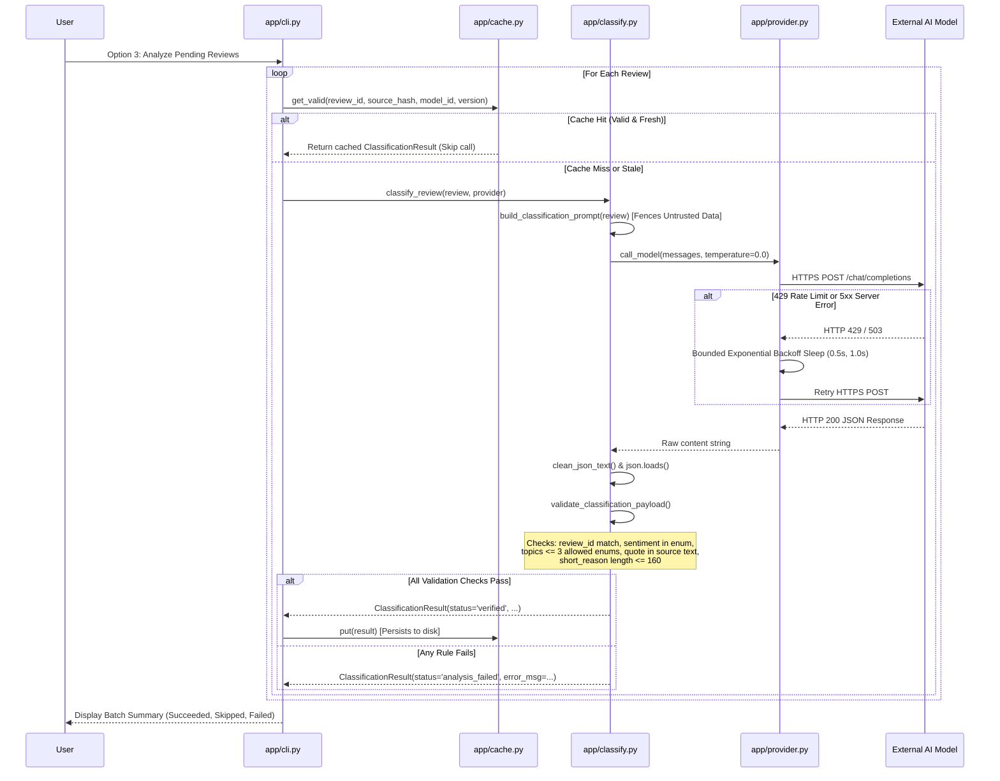

# VibeCheck AI — Architectural Design & Data Flow

## 1. System Overview
VibeCheck AI is structured into decoupled modules with clean boundaries separating data ingestion, provider network communication, schema validation, caching, retrieval, statistical computation, and user interface.

```
                      +-----------------------------+
                      |         CLI Menu            |
                      |       (app/cli.py)          |
                      +--------------+--------------+
                                     |
      +--------------------+---------+---------+--------------------+
      |                    |                   |                    |
+-----v-------+    +-------v-------+   +-------v-------+    +-------v-------+
| Ingestion   |    | Classification|   | Deterministic |    | Evidence      |
| & Validation|    | & Validation  |   | Reporting     |    | Retrieval & QA|
| (ingest.py) |    | (classify.py) |   | (report.py)   |    | (qa.py,       |
+-------------+    +-------+-------+   +---------------+    |  retrieve.py) |
                           |                                +-------+-------+
                   +-------v-------+                                |
                   | Local Cache   |                                |
                   | (cache.py)    |                                |
                   +-------+-------+                                |
                           |                                        |
                   +-------v----------------------------------------v-------+
                   |                     Provider Client                    |
                   |                    (app/provider.py)                   |
                   +------------------------+-------------------------------+
                                            |
                                            v (HTTPS / TLS 1.3)
                               +-------------------------+
                               | Configured AI Endpoint  |
                               | (OpenAI / Groq / etc.)  |
                               +-------------------------+
```

---

## 2. Core Execution Flows

### 2.1 Review Classification Flow: CLI -> Provider -> Model -> Parser


---

## 3. Cryptographic Cache Invalidation (SHA-256)
To guarantee that cached AI inferences never become stale when source feedback text is edited or updated, VibeCheck AI computes a SHA-256 digest of the source text:
$$\text{source\_hash} = \text{SHA256}(\text{review.text.encode('utf-8')})$$

Composite Cache Key:
$$\text{key} = \text{review\_id} : \text{source\_hash} : \text{model\_id} : \text{prompt\_schema\_version}$$

1. **Source Text Mutation**: If a review's wording changes, its `source_hash` changes immediately.
2. **Version Bump**: If system prompt instructions change, bumping `PROMPT_SCHEMA_VERSION` (e.g. from `v1.0.0` to `v1.1.0`) invalidates all previous cache entries without manual deletion.
3. **Model Migration**: Changing `AI_MODEL` automatically causes cache misses for new models while preserving previous records.

---

## 4. Grounded Question-Answering Pipeline
```mermaid
flowchart TD
    Q[User Question] --> R[retrieve.py: Tokenize & Stop-Word Removal]
    R --> S[Deterministic Token Overlap Scoring]
    S --> TopK{Matching Reviews Found?}
    TopK -- No --> Abstain[Return 'Insufficient evidence in the supplied reviews.']
    TopK -- Yes --> Subset[Select Top-k Reviews (Max 5)]
    Subset --> Prompt[Construct Grounded Prompt with Review IDs]
    Prompt --> AI[Call AI Provider (temperature=0.0)]
    AI --> Parse[Defensive JSON Parsing]
    Parse --> CheckCite{Every cited ID in retrieved subset?}
    CheckCite -- No (Hallucinated ID) --> FlagError[Flag Citation Grounding Violation]
    CheckCite -- Yes --> Grounded[Return Grounded Answer with [Rxxx] Citations]
```

---

## 5. Separation of Provenance & Trust Boundaries
VibeCheck AI enforces clear separation of provenance:
1. **Source Data**: Preserved read-only in `Review` objects.
2. **AI Inferences**: Stored as `ClassificationResult` and labeled explicitly as AI-derived inferences.
3. **Statistical Metrics**: Computed solely in Python (`app/report.py`). Totals, frequencies, and percentages are never generated by LLM prompts.
